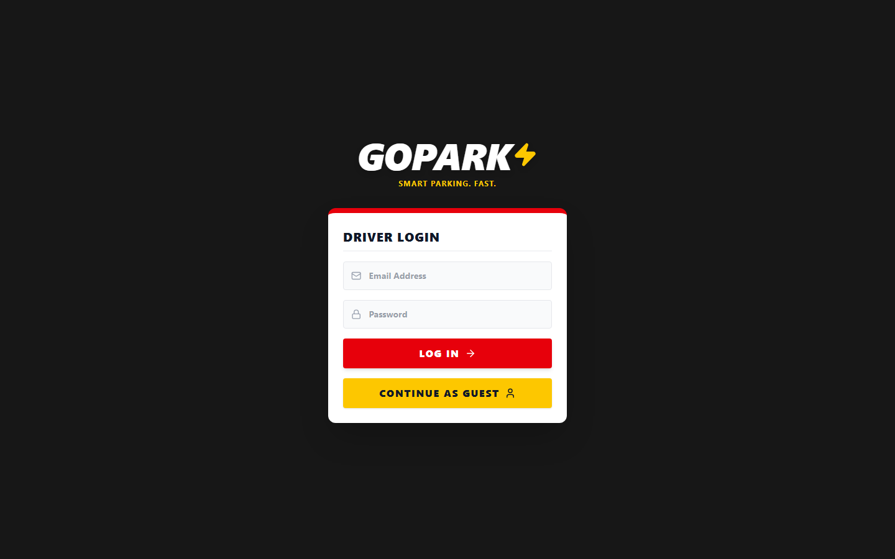

<p align="center">
  
</p>

<h1 align="center">GoPark ⚡</h1>

<p align="center">
  <strong>Smart parking finder for Singapore drivers</strong><br />
  Search any destination, compare nearby carparks by price and walking distance, and get live weather updates — all in one dashboard.
</p>

<p align="center">
  
  
  
  
  
</p>

---

## Screenshots

### Desktop

| Dashboard | Search Results |
|-----------|---------------|
|  |  |

### Mobile

<p align="center">
  
  &nbsp;&nbsp;&nbsp;
  
</p>

---

## Features

- **Destination Search** — geocode any Singapore address via Geoapify and find the closest carparks
- **Carpark Comparison** — view pricing (weekday/weekend), available lots, walk time, and rate type at a glance
- **Interactive Map** — Leaflet-based map with pin markers, popups, and smooth fly-to animations
- **Multiple Map Styles** — switch between OneMap, OpenStreetMap, Google Roads, Google Hybrid, and 3D building views
- **Live Weather** — real-time 2-hour forecast from data.gov.sg, matched to the nearest area
- **Geolocation** — auto-detect and display your current position on the map
- **Favorites** — save preferred carparks (logged-in users)
- **Guest Mode** — browse without an account

---

## Tech Stack

| Layer | Technology |
|-------|-----------|
| Frontend | React 19, TypeScript, Tailwind CSS v4, Vite 8 |
| Map | Leaflet + react-leaflet, OSMBuildings |
| Backend | Node.js, Express, TypeScript |
| Database | PostgreSQL 15 |
| Proxy | nginx (reverse proxy + static assets) |
| Infra | Docker Compose (dev + prod configs) |

---

## Getting Started

### Prerequisites

- [Docker](https://docs.docker.com/get-docker/) and Docker Compose
- API keys for [Geoapify](https://www.geoapify.com/) and optionally [Google Maps](https://developers.google.com/maps)

### Setup

```bash
git clone https://github.com/sharylkwang/gopark.git
cd gopark

cp backend/.env.example backend/.env
# Edit backend/.env with your API keys
```

### Run (Development)

```bash
docker compose up --build
```

The app will be available at **http://localhost**.

| Service | Internal Port | Description |
|---------|--------------|-------------|
| nginx | 80 | Reverse proxy |
| frontend | 5173 | Vite dev server with HMR |
| backend | 3000 | Express API |
| gopark (db) | 5432 | PostgreSQL |

### Run (Production)

```bash
docker compose -f docker-compose.prod.yml up --build -d
```

---

## Project Structure

```
gopark/
├── frontend/
│   └── src/
│       ├── components/
│       │   └── Map/
│       │       ├── index.tsx            # MapView
│       │       ├── CameraFlyer.tsx      # Fly-to animations
│       │       ├── CarparkMarker.tsx    # Pin markers + popups
│       │       ├── TileLayerSwitcher.tsx # Map style picker
│       │       └── layers/
│       │           └── OSMBuildingLayer.tsx
│       ├── config/tiles.ts             # Tile provider configs
│       ├── services/
│       │   ├── api.ts                  # Geocoding API
│       │   ├── buildings.ts            # Building data types
│       │   └── weather.ts             # data.gov.sg weather
│       └── types/
├── backend/
│   └── src/
│       ├── server.ts                   # Express app
│       ├── routes/                     # API endpoints
│       └── services/                   # Tile proxy
├── nginx/                              # Reverse proxy configs
├── docker-compose.yml                  # Dev environment
└── docker-compose.prod.yml             # Prod environment
```

---

## API Keys

| Key | Required | Source | Used For |
|-----|----------|--------|----------|
| `GEOAPIFY_KEY` | Yes | [geoapify.com](https://www.geoapify.com/) | Destination geocoding |
| `GOOGLE_MAPS_KEY` | No | [Google Cloud Console](https://console.cloud.google.com/) | Google Roads/Hybrid tiles |
| `DATAGOVSG_KEY` | No | [data.gov.sg](https://data.gov.sg/) | Carpark availability |

---

## Team

NUS Orbital 2026

---

## License

This project is part of NUS CP2106 (Orbital).
