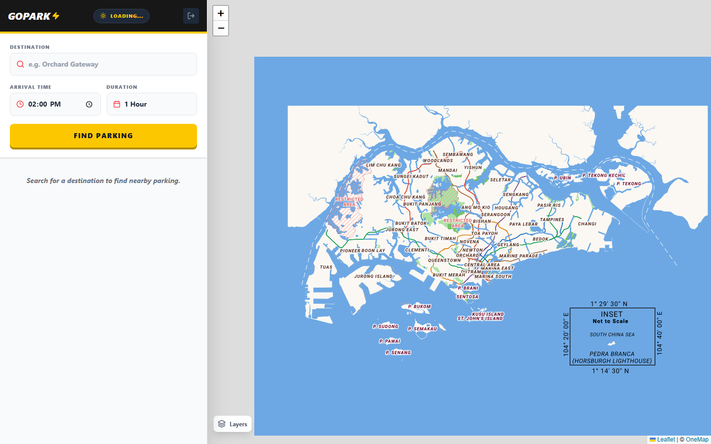
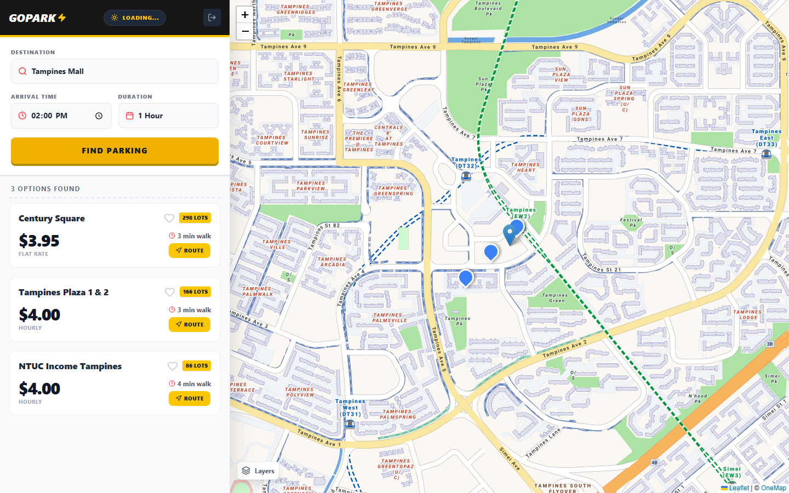
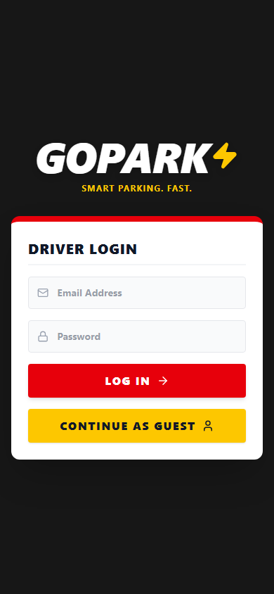
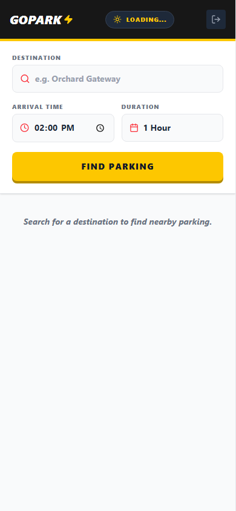

<p align="center">
  
</p>

<h1 align="center">GoPark</h1>

<p align="center">
  <strong>Smart parking finder for Singapore drivers</strong><br />
  Search any destination, compare nearby carparks by price and walking distance, and get live availability and weather updates.
</p>

<p align="center">
  
  
  
  
  
  
</p>

---

## Screenshots

### Desktop

| Dashboard | Search Results |
|-----------|---------------|
|  |  |

### Mobile

<p align="center">
  
  &nbsp;&nbsp;&nbsp;
  
</p>

---

## Features

### Frontend
- **Destination Search** - geocode any Singapore address via Geoapify and find the closest carparks
- **Carpark Comparison** - view pricing (weekday/weekend), available lots, walk time, and rate type at a glance
- **Interactive Map** - Leaflet-based map with pin markers, popups, and smooth fly-to animations
- **Multiple Map Styles** - switch between OneMap, OpenStreetMap, Google Roads, Google Hybrid, and 3D building views
- **3D Buildings** - OSMBuildings overlay with click-to-highlight, powered by Overpass API
- **Live Weather** - real-time 2-hour forecast from data.gov.sg, with optional precise location via tooltip
- **Geolocation** - auto-detect your position, fly to it on load, and display a blue marker
- **Collapsible Sidebar** - full-screen map with an overlay sidebar, responsive on mobile
- **Layer Switcher** - split panel for map providers (top) and feature toggles (bottom)

### Backend
- **Data Pipeline** - merges carpark data from 6+ sources (Gov, DataMall, Parkaholic, SGCarMart, OneMotooring, GetGo, SgBikes)
- **Cron Jobs** - scheduled data fetching with three intervals:
  - Availability refresh: every 2 minutes (Gov, DataMall, Parkaholic)
  - Full merge: every 6 hours (all sources)
  - Scraper: every 30 days (web page discovery + extraction)
- **AI Scraper** - LLM-powered parking rate extraction from web pages
  - DuckDuckGo search for page discovery (not hardcoded URLs)
  - Page cache with SHA-256 change detection
  - 30-day recheck cycle, 6-month stale purge with automatic re-search
  - Supports Z.AI GLM (cloud) or local vLLM as LLM backend
- **Rate Parser** - converts free-text rate strings into structured entries with amount, duration, time periods, vehicle types
- **Proximity Matching** - matches carparks across sources using coordinate distance (~111m threshold)
- **Name Matching** - fuzzy substring matching for scraped rate data against existing carparks
- **Multi-Source Confirmation** - rates found in multiple sources are flagged with `confirmed_by` count
- **Structured Logger** - tagged log levels (debug/info/warn/error) with timestamps, configurable via `LOG_LEVEL`

### Database (Prisma + PostgreSQL)
- **carparks** - unified entries with lat/lng, sources array, JSONB metadata
- **rates** - parsed rate entries with vehicle type, day type, time periods, multi-source tracking
- **availability** - live lot counts per carpark per lot type (Car/Motorcycle/Heavy/Season)
- **scraped_pages** - cached scraper results with change detection
- **scraper_domains** - configurable domains for the AI scraper to search
- **seed_status** - gates cron jobs until initial seed is complete

---

## Tech Stack

| Layer | Technology |
|-------|-----------|
| Frontend | React 19, TypeScript 5.8, Tailwind CSS v4, Vite |
| Map | Leaflet + react-leaflet, OSMBuildings (Overpass API) |
| Backend | Node.js 22, Express 5, TypeScript |
| Database | PostgreSQL 15, Prisma ORM |
| AI/Scraping | Z.AI GLM or vLLM (OpenAI-compatible) |
| Proxy | nginx (reverse proxy) |
| Infra | Docker Compose |

---

## Getting Started

### Prerequisites

- [Docker](https://docs.docker.com/get-docker/) and Docker Compose
- API keys (see [API Keys](#api-keys) below)
- **Optional:** NVIDIA GPU + drivers for local vLLM

### Setup

```bash
git clone https://github.com/sharylkwang/gopark.git
cd gopark

cp .env.example .env
# Edit .env with your API keys
```

### Run

```bash
# Standard (no GPU)
docker compose up --build

# With local vLLM for AI scraping
docker compose --profile gpu up --build
```

The app will be available at **http://localhost**.

See [COMMANDS.md](COMMANDS.md) for all available commands.

---

## Services

| Service | Port | Description |
|---------|------|-------------|
| nginx | 80 | Reverse proxy |
| frontend | 5173 | Vite dev server with HMR |
| backend | 3000 | Express API + cron jobs |
| gopark (db) | 5432 (ext: 5433) | PostgreSQL |
| vllm (gpu profile) | 8100 | vLLM OpenAI-compatible API |

---

## Project Structure

```
gopark/
├── frontend/
│   └── src/
│       ├── components/
│       │   └── Map/
│       │       ├── index.tsx              # MapView with all layers
│       │       ├── CameraFlyer.tsx        # Fly-to animations (user location + search)
│       │       ├── CarparkMarker.tsx      # Pin markers + popups
│       │       ├── TileLayerSwitcher.tsx   # Map style & feature toggle panel
│       │       └── layers/
│       │           └── OSMBuildingLayer.tsx # 3D buildings via Overpass
│       ├── providers/
│       │   ├── govsg/weather.ts           # IP-based + precise weather
│       │   ├── osm/buildings.ts           # Overpass tile fetching + cache
│       │   └── tiles.ts                   # Tile provider configs
│       └── types/
├── backend/
│   ├── prisma/
│   │   └── schema.prisma                  # Database schema
│   └── src/
│       ├── server.ts                      # Express app + cron startup
│       ├── lib/
│       │   └── logger.ts                  # Structured logger
│       ├── db/
│       │   ├── index.ts                   # Prisma client
│       │   └── schema.ts                  # Seed status helpers
│       ├── cron/
│       │   ├── index.ts                   # Scheduler (availability, merge, scraper)
│       │   ├── govsg.ts                   # Gov mapping + availability
│       │   ├── datamall.ts                # LTA DataMall
│       │   ├── parkaholic.ts              # Parkaholic locations + dump + rates
│       │   ├── sgcarmart.ts               # SGCarMart carpark data
│       │   ├── scraper.ts                 # AI-powered web scraper
│       │   ├── merge.ts                   # Multi-source merge pipeline
│       │   └── types.ts                   # Shared types
│       └── providers/
│           ├── geoapify/router.ts         # Geocoding proxy
│           ├── google/router.ts           # Tile proxy + routing
│           └── govsg/router.ts            # Parking availability API
├── nginx/nginx.conf
├── docker-compose.yml
├── docker-compose.prod.yml
└── .env.example
```

---

## API Keys

| Key | Required | Source | Used For |
|-----|----------|--------|----------|
| `GEOAPIFY_KEY` | Yes | [geoapify.com](https://www.geoapify.com/) | Destination geocoding |
| `DATAGOVSG_KEY` | Yes | [data.gov.sg](https://data.gov.sg/) | Carpark availability + mapping |
| `DATAMALL_API` | Yes | [datamall.lta.gov.sg](https://datamall.lta.gov.sg/) | LTA/URA commercial carparks |
| `GOOGLE_MAPS_KEY` | No | [Google Cloud Console](https://console.cloud.google.com/) | Google Roads/Hybrid tiles, routing |
| `ZHIPUAI_API_KEY` | No | [open.bigmodel.cn](https://open.bigmodel.cn/) | Z.AI GLM for AI scraping |

---

## Data Sources

| Source | ID System | Entries | Provides |
|--------|-----------|---------|----------|
| Gov Mapping (data.gov.sg) | `car_park_no` | ~2000 | Location (SVY21), address, carpark type, free parking |
| Gov Availability | `car_park_no` | ~2000 | Live lot counts by type (C/Y/H/S) |
| LTA DataMall | `Agency-CarParkID` | ~500 | Commercial carparks (malls, private developments) |
| Parkaholic | `car_park_no` | ~4700 | Locations, availability, rate text |
| SGCarMart | `SGC-{id}` | ~1100 | Carpark rates (weekday/sat/sun) |
| OneMotooring (LTA) | Name match | Variable | Official LTA parking rates (AI-scraped) |
| GetGo | Name match | Variable | CBD parking rates (AI-scraped) |
| SgBikes | Name match | Variable | Motorcycle parking rates (AI-scraped) |

---

## Team

NUS Orbital 2026

---

## License

This project is part of NUS CP2106 (Orbital).
