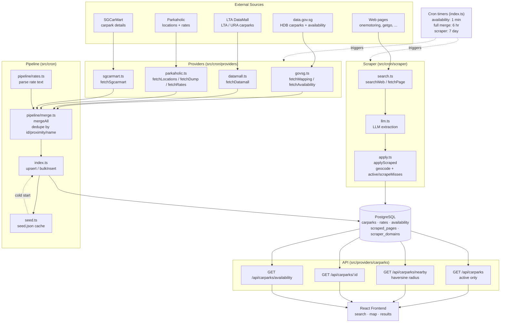

# GoPark — Data Flow

How parking data moves from external sources into the app. Renders natively on GitHub.



## Regenerating diagrams

```bash
# from backend/ — regenerates erd.md (ER diagram) + schema.dbml, strips emoji markers
npm run diagrams
```

`erd.md` and `schema.dbml` are auto-generated from `schema.prisma`. This `dataflow.md` is hand-maintained — edit the Mermaid above when the pipeline changes.
